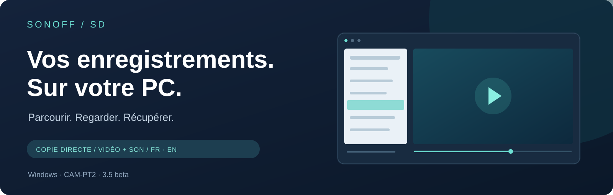
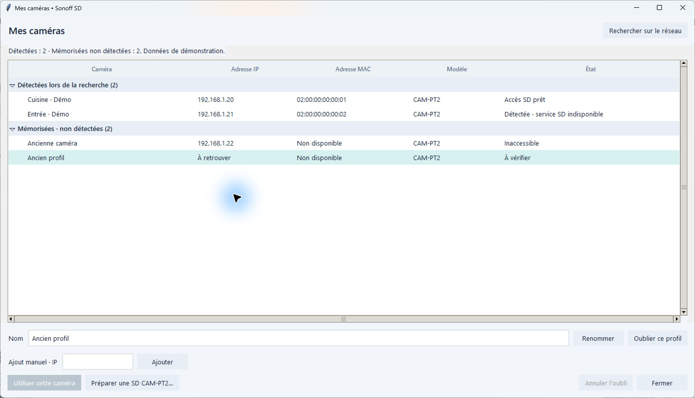
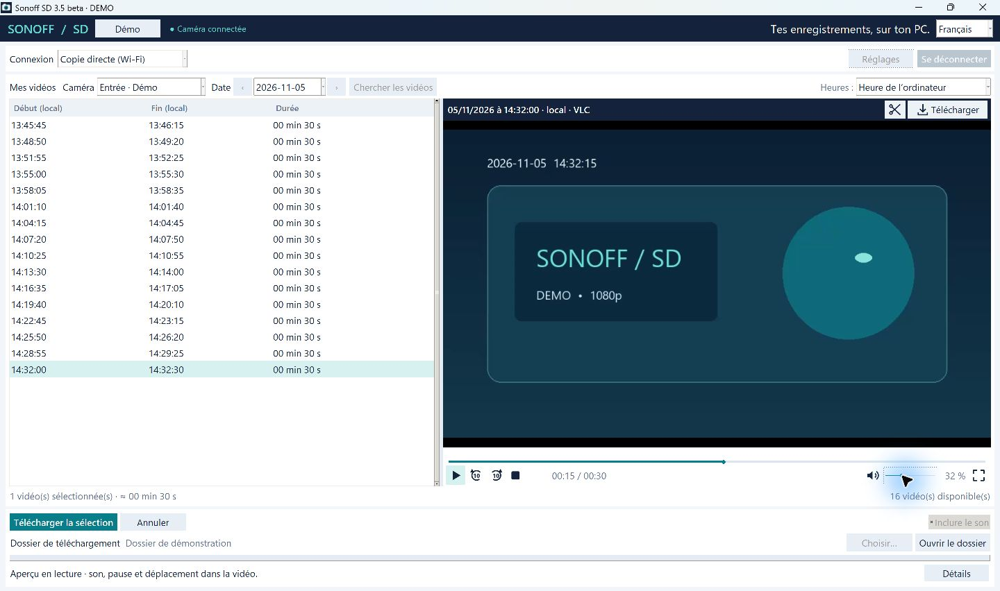
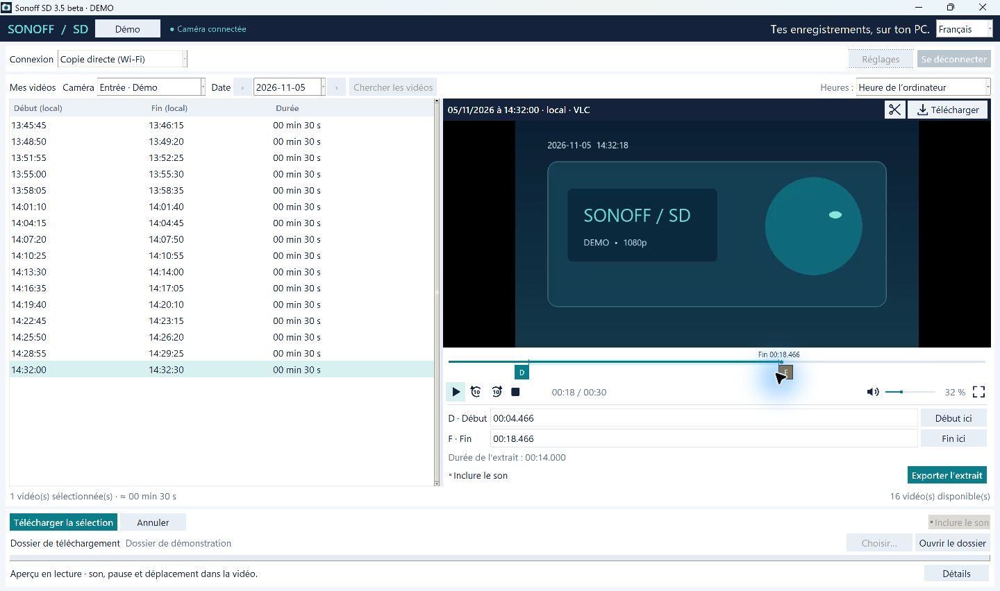
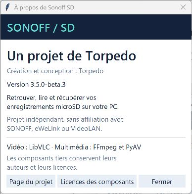

<b>Windows 10 / 11 · 64 bits · Français / English</b> 3.6 bêta 9 · Par Torpedo · Projet indépendant · CAM-PT2, firmware 1.2.2

   
  <a href="README.md">Read in English</a> · <a href="#bien-démarrer">Premiers pas</a> · <a href="https://github.com/Torped00/sonoff-sd-releases/releases">Versions et SHA-256</a>

## Nouveautés de la 3.6 bêta 9

- Pendant la recherche, un grand message et une animation apparaissent dans l’aperçu, avec le bouton « Recherche en cours… ». Les résultats vides, erreurs et annulations sont clairement signalés.
- L’application peut retrouver une caméra connue après un changement d’IP grâce à son identité ONVIF mémorisée et, si disponible, sa MAC locale, puis vérifier l’accès SD authentifié. Le nom seul ne sert jamais d’identité ; en cas d’ambiguïté, vous choisissez la caméra.
- **Mes caméras** est plus grande, redimensionnable et agrandissable. Elle mémorise sa propre taille et sa position, indépendamment de la fenêtre principale.
- Les caméras détectées sont séparées des profils mémorisés non trouvés lors du dernier scan. Vous pouvez oublier un profil local et annuler le dernier oubli tant que la fenêtre reste ouverte, sans supprimer les vidéos ni les clés d’association.

Les améliorations précédentes restent présentes : taille et position de la fenêtre principale et séparation liste/aperçu mémorisées, recherche automatique après connexion, case du son plus lisible et progression détaillée de l’installateur. Une installation complète peut encore prendre quelques minutes.

Données de démonstration synthétiques, sans véritables adresses ni identifiants de caméra.

## Retrouvez le bon moment. Gardez le fichier.

Sonoff SD permet de parcourir les **enregistrements microSD d’une SONOFF CAM-PT2**, de les regarder avec le son et de les récupérer sur un PC Windows, par le réseau local. Une fois la carte préparée, vous transférez le véritable fichier enregistré, sans devoir réenregistrer sa relecture en temps réel. Le délai dépend de la taille du fichier et du réseau.

> **Testé sur une SONOFF CAM-PT2, firmware 1.2.2 — SN-T23N-CAMPT2-01.** D’autres caméras partageant ce firmware ou la même base logicielle pourraient aussi fonctionner : c’est une piste à confirmer, pas une compatibilité déjà validée. Vous avez le même firmware, une autre version ou une autre caméra SONOFF ? **[Vos retours nous intéressent, même pour signaler votre modèle sans l’avoir testé !](#vos-retours)**

Vraie interface de l’application. Vidéo et informations de caméra de démonstration.

| Retrouver | Regarder | Récupérer |
|---|---|---|
| Détecter les caméras du réseau et leur donner un nom. | Lecteur LibVLC intégré : déplacement, volume, sourdine et plein écran. | Copier les originaux vérifiés et exporter des MP4 avec le son. |
| Choisir une date et afficher l’heure du PC ou UTC. | Définir le début et la fin d’un extrait sur la barre de temps. | Garder uniquement le passage utile, en conservant l’original téléchargé. |

## Juste le passage qui vous intéresse

Faites glisser les repères de début et de fin, vérifiez la sélection, puis exportez-la. L’export complet conserve les paquets vidéo ; le découpage précis réencode le passage choisi. Le son A-law de la caméra est converti en AAC pour le MP4 exporté lorsque le son est demandé.

## Bien démarrer

1. Téléchargez et lancez **SonoffSD-Setup-3.6.0-beta.9-win64.exe**. Python et une installation séparée de VLC ne sont pas nécessaires. L’installateur propose séparément les raccourcis **Bureau** et **menu Démarrer** ; ils ouvrent l’application complète.
2. Pour la première préparation, **éteignez la caméra**, retirez sa microSD et branchez-la au PC avec un lecteur de cartes.
3. Dans **Mes caméras → Préparer une SD CAM-PT2**, choisissez la carte amovible et confirmez le modèle et le firmware. Un script de démarrage inconnu est refusé. Aucun formatage, aucune suppression de vidéo.
4. Éjectez la carte, remettez-la dans la caméra éteinte, puis rallumez-la. Attendez environ deux minutes.
5. Sur le même réseau local de confiance, recherchez la caméra ou saisissez son adresse, puis connectez-vous. Les vidéos se chargent automatiquement ; choisissez une autre date si nécessaire, puis lancez un aperçu ou un téléchargement.

**Carte déjà préparée avec une autre installation ?** Importez votre association existante depuis la fenêtre de préparation ; inutile de préparer à nouveau la carte. Sans association, le bouton « Se connecter » ouvre cette fenêtre. Les versions de l’EXE installées sur le même PC partagent leurs réglages utilisateur. Gardez votre fichier d’association privé : il contient les clés d’accès à la caméra. Une nouvelle installation ne connaît pas automatiquement les clés d’une carte déjà préparée.

## Installation, mises à jour et désinstallation

À partir de la version **3.6**, les mises à jour utilisent un dossier d’application unique et un raccourci **Sonoff SD – Torpedo**. L’installateur propose de placer les trois anciennes bêtas 3.5 dans la Corbeille après avoir vérifié tous leurs fichiers. Tout dossier modifié ou non reconnu est conservé et signalé.

Le désinstalleur est accessible dans les **applications installées de Windows**, ainsi que par `Uninstall.exe` dans le dossier de l’application. Les réglages, associations de caméra et vidéos téléchargées sont conservés pour une réinstallation. Désinstaller le logiciel Windows ne désactive pas les fichiers de démarrage présents sur la microSD ; leur retrait reste une opération distincte.

## Si la caméra change d’adresse IP

Une connexion directe réussie permet de mémoriser l’identité ONVIF de la caméra et sa MAC lorsqu’elle est disponible sur le réseau local. Si l’ancienne adresse ne répond plus, l’application lance une recherche limitée puis vérifie l’identité et l’accès SD authentifié avant de remplacer l’adresse mémorisée. Plusieurs caméras peuvent porter le même nom. Si l’identité est absente, contradictoire ou ambiguë, vous choisissez dans **Mes caméras**. Un ancien profil peut nécessiter une sélection manuelle réussie avant que la récupération automatique fonctionne. La MAC peut être indisponible à travers un routeur ou un VPN et ne remplace pas l’authentification.

Nous avons identifié une panne réelle causée par un **ancien script de démarrage SD de développement lié à une IP fixe**. Une correction ciblée du script sur la carte a rétabli l’accès. Les paquets de préparation actuels écoutent déjà indépendamment de l’IP attribuée, mais **mettre à jour l’EXE Windows ne réécrit pas les fichiers présents sur une carte**. Si la caméra est détectée mais que son service SD est indisponible, la préparation de la carte reste à vérifier séparément. Conservez l’association et les vidéos ; ne formatez pas et ne préparez pas à nouveau la carte sans diagnostic. Une réservation DHCP peut stabiliser l’adresse, sans être nécessaire avec un script compatible.

La récupération a été vérifiée avec la vraie caméra de test en simulant une ancienne adresse mémorisée. Un nouveau changement DHCP physique après réparation n’a pas encore été testé de façon indépendante.

**Pourquoi d’anciennes caméras restent-elles affichées ?** Les profils mémorisés ne sont pas les appareils détectés lors du dernier scan. « Oublier ce profil » retire seulement l’entrée locale, en conservant vidéos et clés d’association. Le dernier oubli peut être annulé tant que le gestionnaire reste ouvert. Une caméra toujours présente peut réapparaître au prochain scan. Sa détection seule ne garantit pas la compatibilité de l’accès SD.

## Compatibilité et limites

- **Matériel vérifié à ce jour :** un exemplaire SONOFF CAM-PT2, firmware **1.2.2**, nom du firmware **SN-T23N-CAMPT2-01**.
- **Retour utilisateur positif :** un utilisateur Reddit indique que la référence **SN-CAM-S3W-01**, firmware **1.2.1**, fonctionne en **accès direct Wi-Fi**. Le modèle commercial n’a pas été précisé de façon indépendante. Ce retour utilisateur ne constitue pas un essai supplémentaire en laboratoire.
- **Compatibilité possible, à confirmer :** d’autres exemplaires, révisions ou modèles partageant ce firmware ou sa base logicielle. Le même nom de firmware est une piste ; la marque SONOFF seule ne suffit pas à garantir la compatibilité. Les retours permettront de constituer une liste de configurations confirmées.
- La recherche ONVIF peut détecter d’autres marques. Cela ne signifie pas que l’accès à leurs enregistrements est compatible. Pour un autre modèle ou firmware, partagez d’abord ses références dans un ticket de compatibilité avant de préparer sa carte avec cet outil.
- Les fichiers ajoutés sur la SD démarrent un service HTTP local protégé. Aucun firmware n’est installé. La caméra continue à créer ses enregistrements ; le direct eWeLink a été vérifié sur l’exemplaire testé.
- L’accès local utilise **HTTP authentifié**, sans chiffrement du transport. Utilisez un réseau de confiance et **n’exposez pas le port 8088 à Internet**.
- Cette bêta publique privilégie la copie directe en Wi-Fi. Le mode eWeLink historique nécessite une configuration de client compatible distincte et reste expérimental. Aucun secret de client cloud ni identifiant de compte n’est fourni.
- L’EXE est **non signé numériquement**. Windows peut afficher un avertissement de réputation. Vérifiez l’origine du téléchargement et son SHA-256 dans la release. Le test indépendant sur un PC vierge reste à faire.

## Un projet de Torpedo

**Créé par Torpedo.** Le bouton **À propos · Torpedo** dans l’application présente le créateur, la version, le lien du projet et les licences des composants.

## Questions fréquentes

**Est-ce que télécharger efface la vidéo sur la carte ?**  
Non. L’application lit l’original et vérifie la copie téléchargée. Elle ne demande pas la suppression des enregistrements de la caméra.

**Faut-il ouvrir eWeLink pour copier en local ?**  
Non. L’accès à la carte préparée fonctionne directement sur le réseau local.

**Peut-on annuler la préparation de la carte ?**  
Oui. Le dossier généré `%LOCALAPPDATA%\SonoffSD\sd-setup` contient un lanceur de désactivation. Utilisez-le avec la carte dans le lecteur du PC, en suivant les instructions pour choisir le bon lecteur. Le retrait du déclencheur reconnu rétablit le démarrage habituel au prochain démarrage de la caméra ; les vidéos restent intactes.

**Où est le code de l’application ?**  
Dans un dépôt distinct, privé. Ici se trouvent uniquement la présentation, les guides, les captures et les releases binaires. Les archives « Source code » ajoutées automatiquement par GitHub contiennent cette présentation publique, **pas les sources de l’application**. Un EXE ne garantit pas que son fonctionnement ne puisse pas être inspecté.

**Et les composants libres utilisés ?**  
Leurs notices et les archives de sources disponibles se trouvent dans `_internal/third-party` dans l’application installée. Cette release utilise la distribution LGPL de LibVLC et une compilation LGPL de FFmpeg, avec des bibliothèques remplaçables. Leurs licences accordent leurs propres droits, indépendamment du code privé de l’application.

## Vos retours

**Les réussites nous intéressent autant que les problèmes.** Vous utilisez une CAM-PT2 avec le même firmware, une autre version, ou simplement une autre caméra SONOFF ? [Partagez votre configuration ou votre retour de compatibilité](https://github.com/Torped00/sonoff-sd-releases/issues/new). Vous pouvez aussi signaler un modèle que vous possédez sans avoir effectué de test.

Pour rendre votre retour utile, indiquez :

- la marque, le modèle exact et la révision matérielle si elle est connue ;
- la **version du firmware** et son **nom / « FW name »**, s’ils sont affichés ;
- la version de Sonoff SD et de Windows, ainsi que le mode utilisé (copie directe Wi-Fi ou compte eWeLink) ;
- si vous avez testé ou non ; en cas d’essai, ce qui fonctionne ou bloque : connexion, liste des vidéos, aperçu, téléchargement avec son, extraits et maintien du direct eWeLink.

Un signalement de modèle n’est pas encore une validation. Les essais concluants comme les échecs aideront à préciser la compatibilité et les adaptations possibles.

Retirez adresses e-mail, images privées, adresses IP et clés d’association de vos pièces jointes. N’envoyez jamais vos fichiers d’association, mots de passe, captures réseau ou fichiers keylog.

---

Projet indépendant de **Torpedo**, sans affiliation ni approbation de SONOFF, eWeLink ou VideoLAN. Leurs noms appartiennent à leurs propriétaires respectifs. Ce dépôt n’accorde aucune licence open source sur le code privé de l’application.
