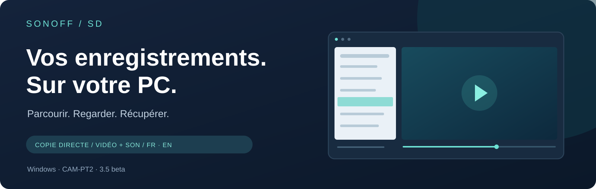
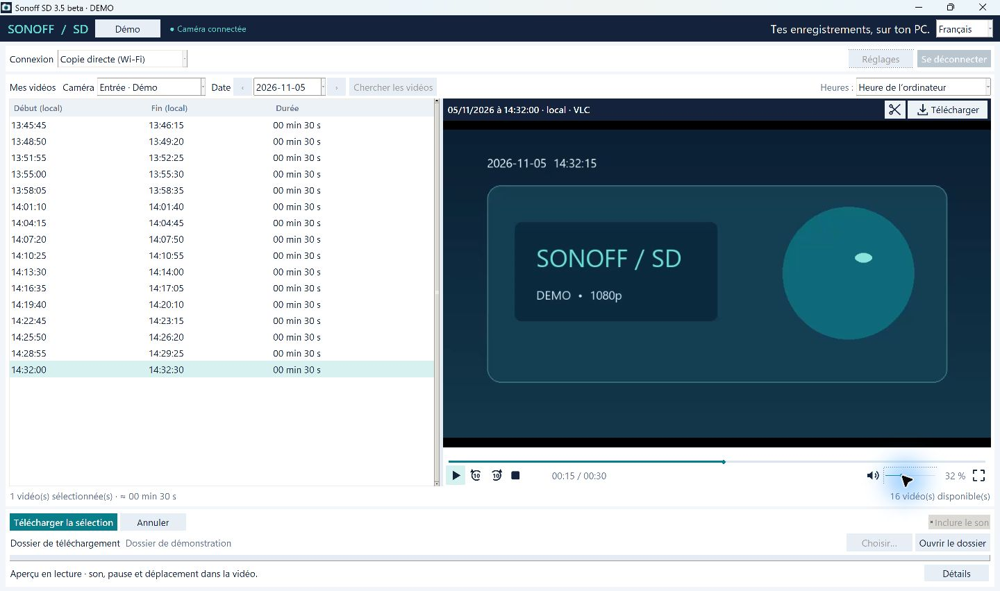
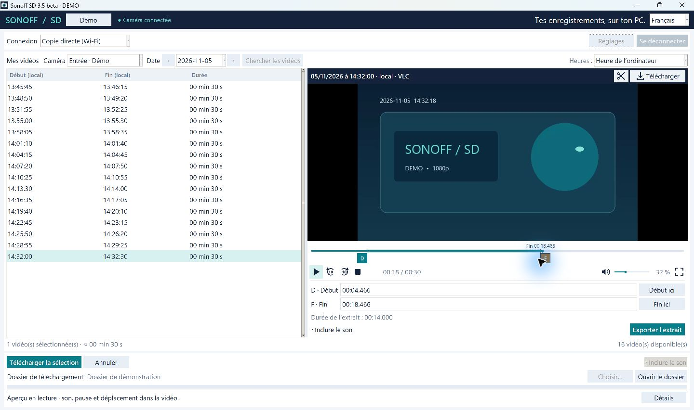

<b>Windows 10 / 11 · 64 bits · Français / English</b> Bêta 2 · Projet indépendant · CAM-PT2, firmware 1.2.2

   
  <a href="README.md">Read in English</a> · <a href="#bien-démarrer">Premiers pas</a> · <a href="https://github.com/Torped00/sonoff-sd-releases/releases">Versions et SHA-256</a>

## Retrouvez le bon moment. Gardez le fichier.

Sonoff SD permet de parcourir les **enregistrements microSD d’une SONOFF CAM-PT2**, de les regarder avec le son et de les récupérer sur un PC Windows, par le réseau local. Une fois la carte préparée, vous transférez le véritable fichier enregistré, sans devoir réenregistrer sa relecture en temps réel. Le délai dépend de la taille du fichier et du réseau.

> **Testé sur une SONOFF CAM-PT2, firmware 1.2.2 — SN-T23N-CAMPT2-01.** D’autres caméras partageant ce firmware ou la même base logicielle pourraient aussi fonctionner : c’est une piste à confirmer, pas une compatibilité déjà validée. Vous avez le même firmware, une autre version ou une autre caméra SONOFF ? **[Vos retours nous intéressent, même pour signaler votre modèle sans l’avoir testé !](#vos-retours)**

Vraie interface de l’application. Vidéo et informations de caméra de démonstration.

| Retrouver | Regarder | Récupérer |
|---|---|---|
| Détecter les caméras du réseau et leur donner un nom. | Lecteur LibVLC intégré : déplacement, volume, sourdine et plein écran. | Copier les originaux vérifiés et exporter des MP4 avec le son. |
| Choisir une date et afficher l’heure du PC ou UTC. | Définir le début et la fin d’un extrait sur la barre de temps. | Garder uniquement le passage utile, en conservant l’original téléchargé. |

## Juste le passage qui vous intéresse

Faites glisser les repères de début et de fin, vérifiez la sélection, puis exportez-la. L’export complet conserve les paquets vidéo ; le découpage précis réencode le passage choisi. Le son A-law de la caméra est converti en AAC pour le MP4 exporté lorsque le son est demandé.

## Bien démarrer

1. Téléchargez et lancez **SonoffSD-Setup-3.5.0-beta.2-win64.exe**. Python et une installation séparée de VLC ne sont pas nécessaires. L’installateur propose séparément les raccourcis **Bureau** et **menu Démarrer** ; ils ouvrent l’application complète.
2. Pour la première préparation, **éteignez la caméra**, retirez sa microSD et branchez-la au PC avec un lecteur de cartes.
3. Dans **Mes caméras → Préparer une SD CAM-PT2**, choisissez la carte amovible et confirmez le modèle et le firmware. Un script de démarrage inconnu est refusé. Aucun formatage, aucune suppression de vidéo.
4. Éjectez la carte, remettez-la dans la caméra éteinte, puis rallumez-la. Attendez environ deux minutes.
5. Sur le même réseau local de confiance, recherchez la caméra ou saisissez son adresse, choisissez une date et lancez un aperçu ou un téléchargement.

**Carte déjà préparée avec une autre installation ?** Importez votre association existante depuis la fenêtre de préparation ; inutile de préparer à nouveau la carte. Sans association, le bouton « Se connecter » ouvre cette fenêtre. Les versions de l’EXE installées sur le même PC partagent leurs réglages utilisateur. Gardez votre fichier d’association privé : il contient les clés d’accès à la caméra. Une nouvelle installation ne connaît pas automatiquement les clés d’une carte déjà préparée.

## Compatibilité et limites

- **Matériel vérifié à ce jour :** un exemplaire SONOFF CAM-PT2, firmware **1.2.2**, nom du firmware **SN-T23N-CAMPT2-01**.
- **Compatibilité possible, à confirmer :** d’autres exemplaires, révisions ou modèles partageant ce firmware ou sa base logicielle. Le même nom de firmware est une piste ; la marque SONOFF seule ne suffit pas à garantir la compatibilité. Les retours permettront de constituer une liste de configurations confirmées.
- La recherche ONVIF peut détecter d’autres marques. Cela ne signifie pas que l’accès à leurs enregistrements est compatible. Pour un autre modèle ou firmware, partagez d’abord ses références dans un ticket de compatibilité avant de préparer sa carte avec cet outil.
- Les fichiers ajoutés sur la SD démarrent un service HTTP local protégé. Aucun firmware n’est installé. La caméra continue à créer ses enregistrements ; le direct eWeLink a été vérifié sur l’exemplaire testé.
- L’accès local utilise **HTTP authentifié**, sans chiffrement du transport. Utilisez un réseau de confiance et **n’exposez pas le port 8088 à Internet**.
- Cette bêta publique privilégie la copie directe en Wi-Fi. Le mode eWeLink historique nécessite une configuration de client compatible distincte et reste expérimental. Aucun secret de client cloud ni identifiant de compte n’est fourni.
- L’EXE est **non signé numériquement**. Windows peut afficher un avertissement de réputation. Vérifiez l’origine du téléchargement et son SHA-256 dans la release. Le test indépendant sur un PC vierge reste à faire.

## Questions fréquentes

**Est-ce que télécharger efface la vidéo sur la carte ?**  
Non. L’application lit l’original et vérifie la copie téléchargée. Elle ne demande pas la suppression des enregistrements de la caméra.

**Faut-il ouvrir eWeLink pour copier en local ?**  
Non. L’accès à la carte préparée fonctionne directement sur le réseau local.

**Peut-on annuler la préparation de la carte ?**  
Oui. Le dossier généré `%LOCALAPPDATA%\SonoffSD\sd-setup` contient un lanceur de désactivation. Utilisez-le avec la carte dans le lecteur du PC, en suivant les instructions pour choisir le bon lecteur. Le retrait du déclencheur reconnu rétablit le démarrage habituel au prochain démarrage de la caméra ; les vidéos restent intactes.

**Où est le code de l’application ?**  
Dans un dépôt distinct, privé. Ici se trouvent uniquement la présentation, les guides, les captures et les releases binaires. Les archives « Source code » ajoutées automatiquement par GitHub contiennent cette présentation publique, **pas les sources de l’application**. Un EXE ne garantit pas que son fonctionnement ne puisse pas être inspecté.

**Et les composants libres utilisés ?**  
Leurs notices et les archives de sources disponibles se trouvent dans `_internal/third-party` dans l’application installée. Cette release utilise la distribution LGPL de LibVLC et une compilation LGPL de FFmpeg, avec des bibliothèques remplaçables. Leurs licences accordent leurs propres droits, indépendamment du code privé de l’application.

## Vos retours

**Les réussites nous intéressent autant que les problèmes.** Vous utilisez une CAM-PT2 avec le même firmware, une autre version, ou simplement une autre caméra SONOFF ? [Partagez votre configuration ou votre retour de compatibilité](https://github.com/Torped00/sonoff-sd-releases/issues/new). Vous pouvez aussi signaler un modèle que vous possédez sans avoir effectué de test.

Pour rendre votre retour utile, indiquez :

- la marque, le modèle exact et la révision matérielle si elle est connue ;
- la **version du firmware** et son **nom / « FW name »**, s’ils sont affichés ;
- la version de Sonoff SD et de Windows ;
- si vous avez testé ou non ; en cas d’essai, ce qui fonctionne ou bloque : connexion, liste des vidéos, aperçu, téléchargement avec son, extraits et maintien du direct eWeLink.

Un signalement de modèle n’est pas encore une validation. Les essais concluants comme les échecs aideront à préciser la compatibilité et les adaptations possibles.

Retirez adresses e-mail, images privées, adresses IP et clés d’association de vos pièces jointes. N’envoyez jamais vos fichiers d’association, mots de passe, captures réseau ou fichiers keylog.

---

Projet indépendant de **Torped00**, sans affiliation ni approbation de SONOFF, eWeLink ou VideoLAN. Leurs noms appartiennent à leurs propriétaires respectifs. Ce dépôt n’accorde aucune licence open source sur le code privé de l’application.
