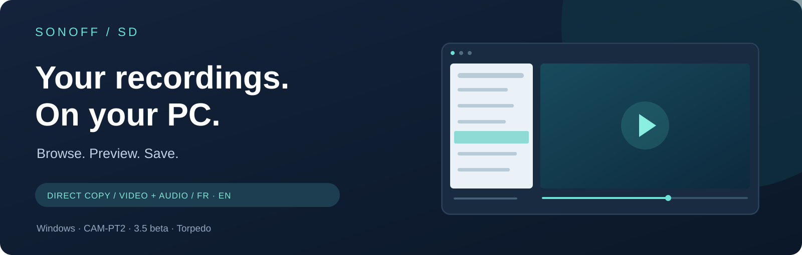
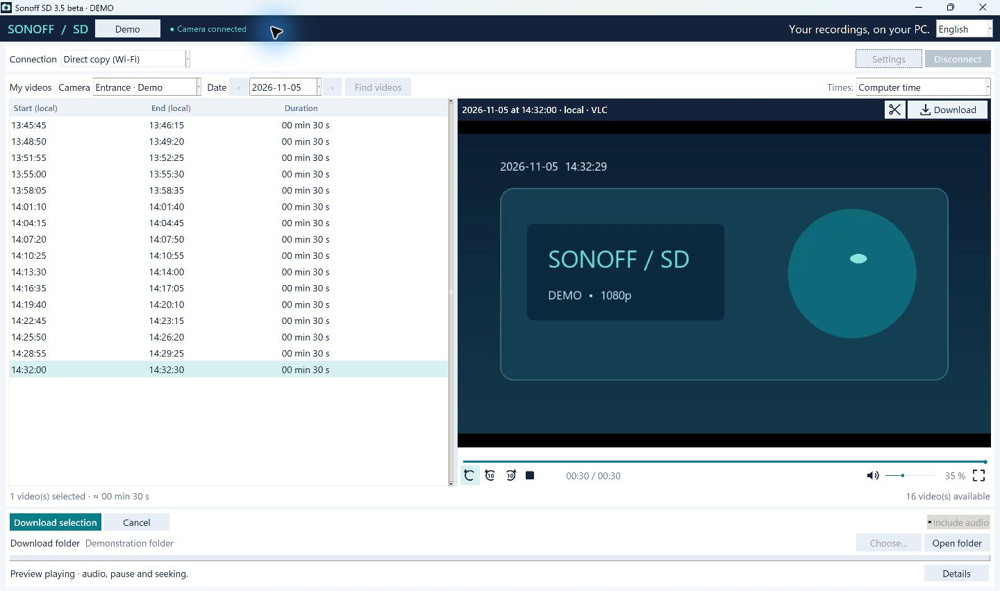
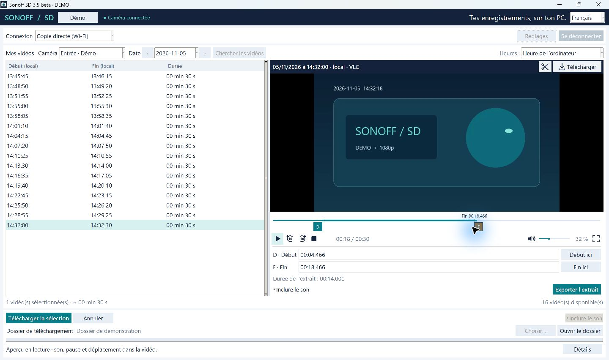

  <b>Windows 10 / 11 · 64-bit · Français / English</b> 
  First public beta · Independently developed · CAM-PT2 firmware 1.2.2

   
  <a href="README.fr.md">Lire en français</a> · <a href="#get-started">Getting started</a> · <a href="https://github.com/Torped00/sonoff-sd-releases/releases">Release notes & SHA-256</a>

## Find the moment. Keep the file.

Sonoff SD lets you browse your **SONOFF CAM-PT2 microSD recordings**, preview them with sound, and save them to your Windows PC over your local network. Once the card is prepared, you can transfer the actual recording file instead of recording a playback in real time. Transfer time depends on the file size and your network.

> **Tested on one SONOFF CAM-PT2, firmware 1.2.2 — SN-T23N-CAMPT2-01.** Other cameras sharing this firmware or its software base may also work; this is a possibility to investigate, not confirmed compatibility. Have the same firmware, a different version or another SONOFF camera? **[We welcome your feedback, even if you only want to report your model without testing it!](#feedback)**

Actual application interface. Synthetic demonstration footage and camera details.

| Browse | Watch | Save |
|---|---|---|
| Find cameras on your local network and give them recognisable names. | Embedded LibVLC player with seeking, volume, mute and full screen. | Copy verified originals and export MP4 files with audio. |
| Browse recordings by date in computer time or UTC. | Set clip boundaries directly on the timeline. | Export just the passage you need; retain the downloaded original. |

## Keep just the part that matters

Drag the start and end handles, check the passage, then export it. Full-file exports preserve the video packets; precise clips re-encode the selected passage. Camera A-law audio is converted to AAC for the exported MP4 when requested.

## Get started

1. Download and run **SonoffSD-Setup-3.5.0-beta.1-win64.exe**. Python and a separate VLC installation are not required.
2. For the initial setup, power the camera **off**, remove its microSD card and connect it to the PC with a card reader.
3. In **My cameras → Prepare a CAM-PT2 SD card**, select the removable card and confirm the model and firmware. Existing unrecognised startup scripts are refused. The card is not formatted and recordings are not deleted.
4. Eject the card, insert it into the powered-off camera, and power it on. Allow about two minutes for startup.
5. Keep the camera and PC on the same trusted local network. Find or enter the camera, choose a date and preview or download your recordings.

**Already using Sonoff SD on another installation?** Import your existing pairing in the card preparation window. Keep pairing files private: they contain camera access keys. A new installation does not automatically know an existing card’s keys.

## Compatibility & limits

- **Hardware verified so far:** one SONOFF CAM-PT2 unit, firmware **1.2.2**, firmware name **SN-T23N-CAMPT2-01**.
- **Potential compatibility, awaiting confirmation:** other units, revisions or models sharing this firmware or its software base. A matching firmware name is a useful lead; the SONOFF brand alone does not guarantee compatibility. Community reports will help build a list of confirmed configurations.
- Discovery can find other brands through ONVIF. Detection does **not** mean their SD recordings are compatible. For another model or firmware, first share its details in a compatibility issue before preparing its card with this helper.
- The SD helper starts a protected local HTTP service. It does not install camera firmware. Recordings continue to be created by the camera; eWeLink live view was verified on the tested unit.
- Access uses authenticated **HTTP on the LAN**, without transport encryption. Use a trusted network and **do not expose port 8088 to the Internet**.
- The public beta focuses on direct Wi-Fi file access. The legacy eWeLink path requires a separately configured compatible client and remains experimental; no cloud client secrets or account credentials are provided.
- This EXE is **not digitally signed**. Windows may display a reputation warning. Verify the download location and the SHA-256 published with the release. An independent clean-PC test is still pending.

## Questions

**Does downloading remove the recording from the card?**  
No. The application reads the original and verifies the downloaded copy. It does not request deletion of camera recordings.

**Do I need to open eWeLink for local copies?**  
No. Prepared-card access works directly on the local network.

**Can I undo the card preparation?**  
Yes. The generated setup folder in `%LOCALAPPDATA%\SonoffSD\sd-setup` includes a disable launcher. Use it with the card in the PC reader and follow the selected-drive instructions. Removing the recognised trigger restores normal startup on the next camera boot; videos remain untouched.

**Where are the application sources?**  
They are kept in a separate private repository. This public repository contains the presentation, user documentation, screenshots and binary releases only. GitHub’s automatic “Source code” archives contain these public presentation files, **not the application sources**. An EXE is not a guarantee that its implementation cannot be inspected.

**What about third-party components?**  
Their notices and available source archives are included under `_internal/third-party` in the installed application. The release uses the LGPL LibVLC distribution and an LGPL FFmpeg build, with replaceable library files. Third-party licences grant their own rights independently of the private application code.

## Feedback

**Successful configurations are as useful as bug reports.** Do you have a CAM-PT2 with the same firmware, a different version, or another SONOFF camera? [Share your configuration or compatibility results](https://github.com/Torped00/sonoff-sd-releases/issues/new). You can also report a model you own without having tested it.

Please include:

- the brand, exact model and hardware revision, if known;
- the **firmware version** and **firmware name / “FW name”**, if shown;
- your Sonoff SD and Windows versions;
- whether you tested it; if so, what works or fails: connection, recording list, preview, downloads with audio, clips and continued eWeLink live view.

A model report is not yet a compatibility confirmation. Both successes and failures will help identify supported configurations and possible adaptations.

Remove email addresses, camera images, IP addresses and pairing keys from anything you share. Never attach pairing JSON, account passwords or capture/keylog files.

---

Sonoff SD is an independent project by **Torped00**. It is not affiliated with, endorsed by, or supported by SONOFF, eWeLink or VideoLAN. Their names remain the property of their respective owners. No open-source licence is granted for the application’s private code by this repository.
