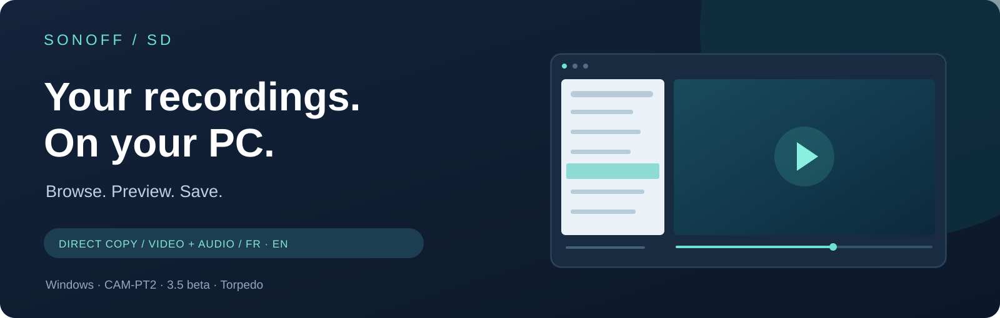
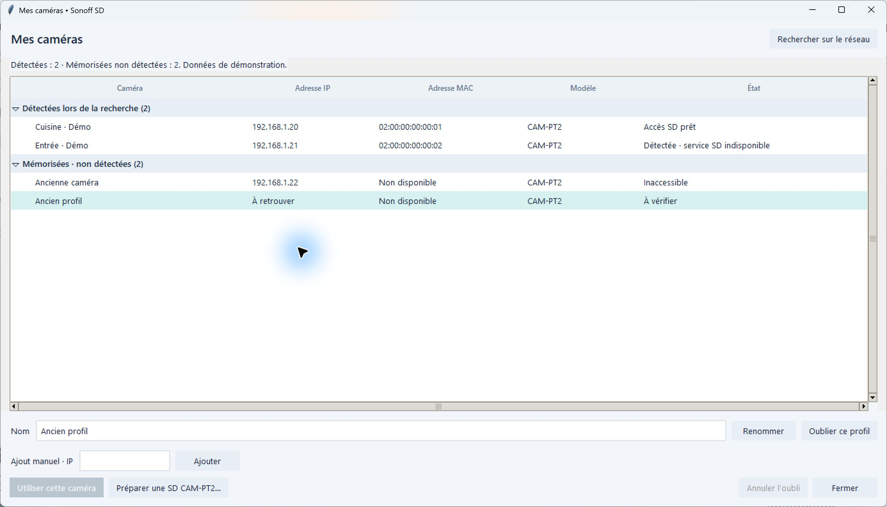
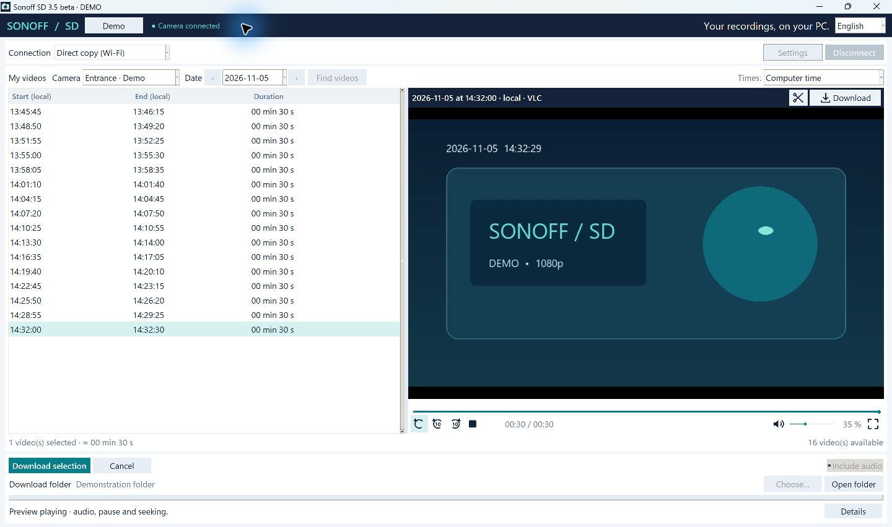
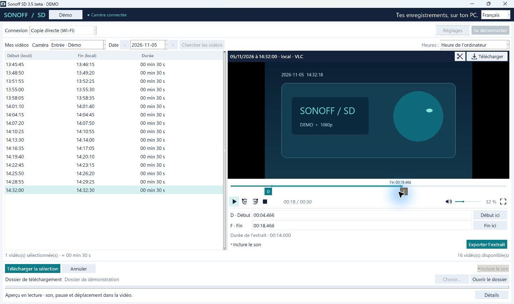
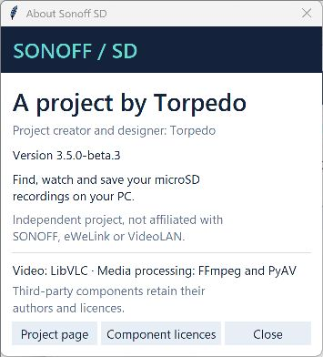

  <b>Windows 10 / 11 · 64-bit · Français / English</b> 
  3.6 beta 9 · By Torpedo · Independently developed · CAM-PT2 firmware 1.2.2

   
  <a href="README.fr.md">Lire en français</a> · <a href="#get-started">Getting started</a> · <a href="https://github.com/Torped00/sonoff-sd-releases/releases">Release notes & SHA-256</a>

## New in 3.6 beta 9

- Recording searches show a large message and an animated progress indicator in the preview, plus a “Searching…” button. Empty results, errors and cancellation have clear outcomes.
- The app can recover a known camera after its IP changes, using its remembered ONVIF identity and, when available, its local MAC address, followed by authenticated SD access. Names alone are never used to identify a camera; ambiguous matches require your choice.
- **My cameras** is larger, resizable and maximizable. It remembers its own size and screen position separately from the main window.
- Detected cameras are grouped separately from saved profiles not found in the latest scan. You can forget a local profile and undo the last removal while the manager stays open, without deleting recordings or pairing keys.

Earlier improvements are retained: remembered main-window size, position and list/preview divider; automatic searches after connection; a clearer audio checkbox; and detailed installer progress. A full installation can still take a few minutes.

French interface. Synthetic demonstration data, not real camera addresses or identifiers.

## Find the moment. Keep the file.

Sonoff SD lets you browse your **SONOFF CAM-PT2 microSD recordings**, preview them with sound, and save them to your Windows PC over your local network. Once the card is prepared, you can transfer the actual recording file instead of recording a playback in real time. Transfer time depends on the file size and your network.

> **Tested on one SONOFF CAM-PT2, firmware 1.2.2 — SN-T23N-CAMPT2-01.** Other cameras sharing this firmware or its software base may also work; this is a possibility to investigate, not confirmed compatibility. Have the same firmware, a different version or another SONOFF camera? **[We welcome your feedback, even if you only want to report your model without testing it!](#feedback)**

Actual application interface. Synthetic demonstration footage and camera details.

| Browse | Watch | Save |
|---|---|---|
| Find cameras on your local network and give them recognisable names. | Embedded LibVLC player with seeking, volume, mute and full screen. | Copy verified originals and export MP4 files with audio. |
| Browse recordings by date in computer time or UTC. | Set clip boundaries directly on the timeline. | Export just the passage you need; retain the downloaded original. |

## Keep just the part that matters

Drag the start and end handles, check the passage, then export it. Full-file exports preserve the video packets; precise clips re-encode the selected passage. Camera A-law audio is converted to AAC for the exported MP4 when requested.

## Get started

1. Download and run **SonoffSD-Setup-3.6.0-beta.9-win64.exe**. Python and a separate VLC installation are not required. The installer offers separate **Desktop** and **Start menu** shortcuts; both open the complete application.
2. For the initial setup, power the camera **off**, remove its microSD card and connect it to the PC with a card reader.
3. In **My cameras → Prepare a CAM-PT2 SD card**, select the removable card and confirm the model and firmware. Existing unrecognised startup scripts are refused. The card is not formatted and recordings are not deleted.
4. Eject the card, insert it into the powered-off camera, and power it on. Allow about two minutes for startup.
5. Keep the camera and PC on the same trusted local network. Find or enter the camera and connect. Recordings load automatically; choose another date when needed, then preview or download.

**Card already prepared with another installation?** Import its existing pairing in the card preparation window; do not prepare the card again. Without a pairing, Connect opens this window. EXE versions installed on the same PC share per-user settings. Keep pairing files private: they contain camera access keys. A new installation does not automatically know an existing card’s keys.

## Installation, updates and uninstall

Starting with **3.6**, updates use one application folder and a stable **Sonoff SD – Torpedo** shortcut. The installer offers to move the three older 3.5 betas to the Recycle Bin after verifying all their files. Modified or unrecognised folders are preserved and reported.

The uninstaller is available in **Windows installed apps**, or through `Uninstall.exe` in the application folder. Settings, camera pairings and downloaded videos are kept for reinstallation. Uninstalling the Windows application does not disable the startup files on the microSD card; removing those remains a separate operation.

## When the camera changes IP

A successful direct connection lets the app remember the camera’s ONVIF identity and its MAC address when locally available. If the saved address stops responding, the app tries a bounded network search and checks the identity and authenticated SD access before changing the saved address. Duplicate camera names are fine. Missing, conflicting or ambiguous identity information requires a manual choice in **My cameras**. An older profile may need one successful manual selection before automatic recovery can work. MAC information may be unavailable across routers or VPNs and is not a replacement for authentication.

We traced one real failure to an **old development SD startup script bound to a fixed IP**. A separate, targeted card-script repair restored access. Current helper packages already listen independently of the assigned IP, but **updating the Windows EXE does not rewrite files already on a card**. If detection works but the SD service does not, check the card preparation separately. Keep the existing pairing and recordings; do not format or blindly prepare the card again. A DHCP reservation can help keep addresses stable, but a compatible helper does not require it.

Recovery was checked against the real test camera using a simulated stale saved address. A fresh physical DHCP reassignment after the repair has not been independently tested.

**Why are old cameras still listed?** Saved profiles are not the same as devices found in the latest scan. “Forget this profile” only removes the local list entry. It keeps recordings and pairing keys, and the last removal can be undone while the manager stays open. A camera still online may appear again in a later scan. Detection alone does not establish SD compatibility.

## Compatibility & limits

- **Hardware verified so far:** one SONOFF CAM-PT2 unit, firmware **1.2.2**, firmware name **SN-T23N-CAMPT2-01**.
- **Community-reported success:** a Reddit user reports that reference **SN-CAM-S3W-01**, firmware **1.2.1**, works using **direct Wi-Fi access**. The commercial model has not been independently clarified. This is a user report, not a separate lab test.
- **Potential compatibility, awaiting confirmation:** other units, revisions or models sharing this firmware or its software base. A matching firmware name is a useful lead; the SONOFF brand alone does not guarantee compatibility. Community reports will help build a list of confirmed configurations.
- Discovery can find other brands through ONVIF. Detection does **not** mean their SD recordings are compatible. For another model or firmware, first share its details in a compatibility issue before preparing its card with this helper.
- The SD helper starts a protected local HTTP service. It does not install camera firmware. Recordings continue to be created by the camera; eWeLink live view was verified on the tested unit.
- Access uses authenticated **HTTP on the LAN**, without transport encryption. Use a trusted network and **do not expose port 8088 to the Internet**.
- The public beta focuses on direct Wi-Fi file access. The legacy eWeLink path requires a separately configured compatible client and remains experimental; no cloud client secrets or account credentials are provided.
- This EXE is **not digitally signed**. Windows may display a reputation warning. Verify the download location and the SHA-256 published with the release. An independent clean-PC test is still pending.

## A project by Torpedo

**Created by Torpedo.** The **About · Torpedo** button shows the project creator, version, project link and component licences.

## Questions

**Does downloading remove the recording from the card?**  
No. The application reads the original and verifies the downloaded copy. It does not request deletion of camera recordings.

**Do I need to open eWeLink for local copies?**  
No. Prepared-card access works directly on the local network.

**Can I undo the card preparation?**  
Yes. The generated setup folder in `%LOCALAPPDATA%\SonoffSD\sd-setup` includes a disable launcher. Use it with the card in the PC reader and follow the selected-drive instructions. Removing the recognised trigger restores normal startup on the next camera boot; videos remain untouched.

**Where are the application sources?**  
They are kept in a separate private repository. This public repository contains the presentation, user documentation, screenshots and binary releases only. GitHub’s automatic “Source code” archives contain these public presentation files, **not the application sources**. An EXE is not a guarantee that its implementation cannot be inspected.

**What about third-party components?**  
Their notices and available source archives are included under `_internal/third-party` in the installed application. The release uses the LGPL LibVLC distribution and an LGPL FFmpeg build, with replaceable library files. Third-party licences grant their own rights independently of the private application code.

## Feedback

**Successful configurations are as useful as bug reports.** Do you have a CAM-PT2 with the same firmware, a different version, or another SONOFF camera? [Share your configuration or compatibility results](https://github.com/Torped00/sonoff-sd-releases/issues/new). You can also report a model you own without having tested it.

Please include:

- the brand, exact model and hardware revision, if known;
- the **firmware version** and **firmware name / “FW name”**, if shown;
- your Sonoff SD and Windows versions, and the access mode used (direct Wi-Fi or eWeLink account);
- whether you tested it; if so, what works or fails: connection, recording list, preview, downloads with audio, clips and continued eWeLink live view.

A model report is not yet a compatibility confirmation. Both successes and failures will help identify supported configurations and possible adaptations.

Remove email addresses, camera images, IP addresses and pairing keys from anything you share. Never attach pairing JSON, account passwords or capture/keylog files.

---

Sonoff SD is an independent project by **Torpedo**. It is not affiliated with, endorsed by, or supported by SONOFF, eWeLink or VideoLAN. Their names remain the property of their respective owners. No open-source licence is granted for the application’s private code by this repository.
